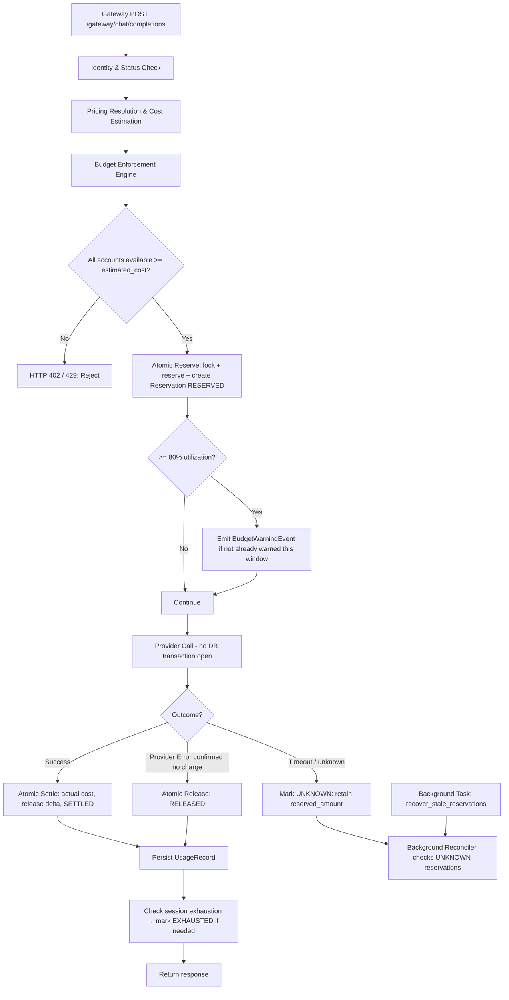
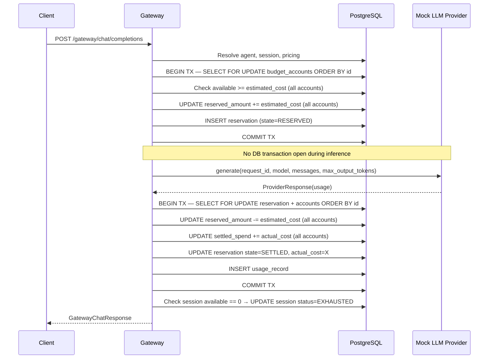
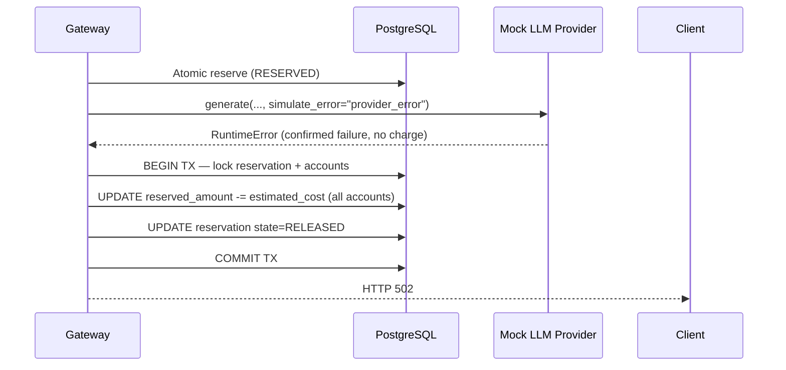
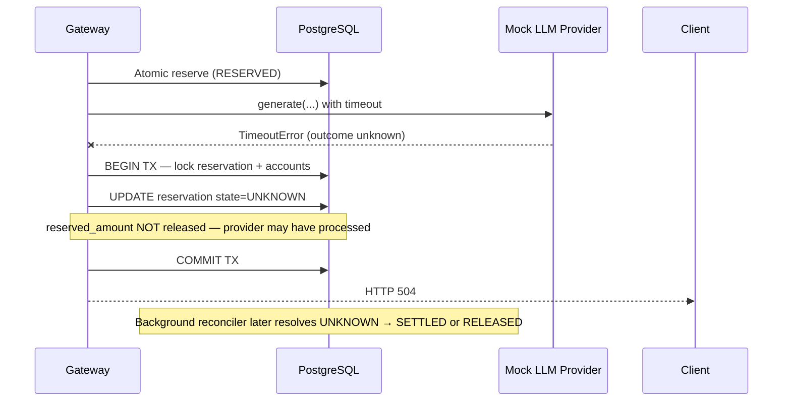
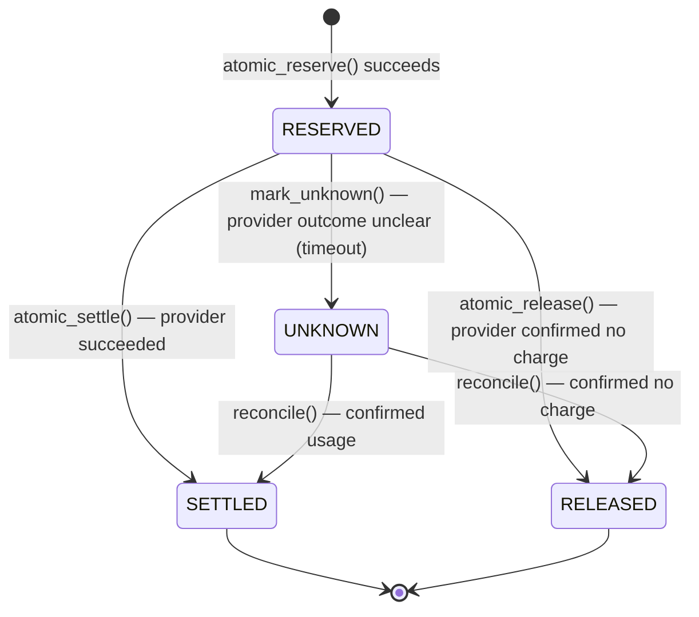

# Design Document: Phase 4 — Atomic Budget Enforcement

## Overview

Phase 4 wires atomic reservation and settlement into the AgentGuard gateway. Before any provider call, the gateway locks all applicable budget accounts (team, agent, session) in a deterministic order and reserves the estimated maximum cost in a single transaction. After the provider responds, it settles the actual cost and releases the unused reserved amount. If the provider call fails or times out before a known outcome, the reservation moves to an UNKNOWN state for safe reconciliation rather than being silently released.

This phase also introduces 80% utilization warnings (once per budget window), 100% hard-block rejection, automatic session closure on budget exhaustion, and a background recovery path for stale reservations left behind by process crashes.

The existing stubs in `backend/app/domain/reservation.py` are refactored to be used inside a broader transaction context managed by the gateway, rather than committing independently.

---

## Architecture



---

## Sequence Diagrams

### Happy Path: Reservation → Settlement



### Failure Path: Provider Error → Release



### Timeout Path → UNKNOWN



---

## Components and Interfaces

### EnforcementService

Central orchestration component that the gateway calls. Coordinates reservation, provider invocation, and settlement within the gateway handler.

**Interface**:

```python
class EnforcementService:
    async def reserve(
        self,
        db: AsyncSession,
        account_ids: list[str],
        estimated_cost: Decimal,
        request_id: str,
        team_id: str,
        agent_id: str,
        session_id: str,
    ) -> bool:
        """Lock accounts in sorted order, check all available >= estimated_cost,
        create RESERVED reservation, update reserved_amount. Returns False if
        any account has insufficient funds."""

    async def settle(
        self,
        db: AsyncSession,
        account_ids: list[str],
        estimated_cost: Decimal,
        actual_cost: Decimal,
        request_id: str,
    ) -> None:
        """Lock reservation + accounts, verify state==RESERVED (idempotency guard),
        release reserved_amount, add actual_cost to settled_spend, mark SETTLED."""

    async def release(
        self,
        db: AsyncSession,
        account_ids: list[str],
        estimated_cost: Decimal,
        request_id: str,
    ) -> None:
        """Lock reservation + accounts, verify state==RESERVED,
        release reserved_amount, mark RELEASED."""

    async def mark_unknown(
        self,
        db: AsyncSession,
        request_id: str,
    ) -> None:
        """Lock reservation, verify state==RESERVED, mark UNKNOWN.
        Does NOT release reserved_amount — provider may have processed the call."""
```

### BudgetWarningService

Tracks whether a 80%-threshold warning has already been emitted for a given budget account in the current budget window, preventing repeated warnings on every request.

**Interface**:

```python
class BudgetWarningService:
    async def check_and_emit(
        self,
        db: AsyncSession,
        accounts: list[BudgetAccount],
        policies: dict[str, BudgetPolicy],
    ) -> list[BudgetWarningEvent]:
        """For each account: if committed/limit >= threshold_pct/100 and no
        BudgetWarningEvent exists for this account in the current window,
        insert one. Returns newly created events."""
```

### SessionExhaustionService

Checks whether a session's budget account has been fully consumed after settlement, and if so transitions the session to EXHAUSTED.

**Interface**:

```python
class SessionExhaustionService:
    async def check_and_close(
        self,
        db: AsyncSession,
        session_id: str,
    ) -> bool:
        """If session's BudgetAccount.available <= 0 after settlement,
        set Session.status = EXHAUSTED. Returns True if session was closed."""
```

### ReservationRecoveryService

Background service that finds RESERVED reservations older than a configurable staleness threshold and transitions them to UNKNOWN for reconciliation.

**Interface**:

```python
class ReservationRecoveryService:
    async def recover_stale(
        self,
        db: AsyncSession,
        staleness_minutes: int = 60,
    ) -> list[str]:
        """Find reservations in RESERVED state older than staleness_minutes.
        Transition each to UNKNOWN (do not release reserved_amount).
        Returns list of affected reservation IDs."""
```

---

## Data Models

### BudgetAccount (existing — no schema change)

```python
class BudgetAccount(Base):
    id: str                    # equals team_id, agent_id, or session_id
    policy_id: str | None
    budget_limit: Decimal      # NUMERIC(14,6)
    settled_spend: Decimal     # NUMERIC(14,6), default 0
    reserved_amount: Decimal   # NUMERIC(14,6), default 0
    updated_at: datetime

    @property
    def available(self) -> Decimal:
        return self.budget_limit - (self.settled_spend + self.reserved_amount)

    @property
    def committed(self) -> Decimal:
        return self.settled_spend + self.reserved_amount

    @property
    def utilization_pct(self) -> Decimal:
        if self.budget_limit == 0:
            return Decimal("100")
        return (self.committed / self.budget_limit * 100).quantize(Decimal("0.01"))
```

**Validation rules**:
- `budget_limit >= 0`
- `settled_spend >= 0`
- `reserved_amount >= 0`
- `available` may be negative only during active overrun reconciliation

### Reservation (existing — no schema change)

```python
class Reservation(Base):
    id: str               # == request_id (idempotency key)
    agent_id: str
    team_id: str
    session_id: str
    estimated_cost: Decimal
    actual_cost: Decimal  # default 0, set on settlement
    state: ReservationState
    created_at: datetime
```

**State machine**:



**Validation rules**:
- A reservation in SETTLED or RELEASED state must not be modified
- `actual_cost` is only set during transition to SETTLED
- Transitions to SETTLED/RELEASED/UNKNOWN are idempotent: re-attempting the same transition on an already-transitioned reservation is a no-op (not an error)

### BudgetWarningEvent (new model)

```python
class BudgetWarningEvent(Base):
    __tablename__ = "budget_warning_events"

    id: str                  # generated UUID
    account_id: str          # FK to budget_accounts.id
    threshold_pct: int       # the threshold that triggered this warning
    utilization_pct: Decimal # utilization at time of warning
    window_key: str          # identifies the budget window (e.g. "2025-01" for MONTHLY)
    created_at: datetime
```

**Validation rules**:
- Unique constraint on `(account_id, window_key)` to prevent duplicate warnings per window
- `window_key` for MONTHLY budgets = "YYYY-MM"; for SESSION_LIFETIME = session_id; for ROLLING_30_DAYS = ISO week

---

## Algorithmic Pseudocode

### Main Enforcement Algorithm (gateway integration)

```pascal
ALGORITHM enforce_and_call(request, db, provider)
INPUT: GatewayChatRequest, AsyncSession, AbstractLLMProvider
OUTPUT: GatewayChatResponse

BEGIN
  ASSERT agent.status == ACTIVE
  ASSERT session.status == ACTIVE

  pricing ← resolve_pricing(db, provider_name, request.model)
  estimated_cost ← calculate_estimated_cost(input_tokens, max_output_tokens, pricing)

  account_ids ← [team_account_id, agent_account_id, session_account_id]

  reserved ← await atomic_reserve(db, account_ids, estimated_cost, request.request_id, ...)
  IF reserved == False THEN
    RETURN HTTP 402 "Insufficient budget"
  END IF

  AWAIT check_and_emit_warnings(db, account_ids)

  provider_response ← None
  outcome ← "unknown"

  TRY
    provider_response ← await provider.generate(...)
    outcome ← "success"
  CATCH TimeoutError
    outcome ← "timeout"
  CATCH RuntimeError (confirmed provider error)
    outcome ← "provider_error"
  END TRY

  IF outcome == "success" THEN
    actual_cost ← calculate_actual_cost(actual_tokens, pricing)
    await atomic_settle(db, account_ids, estimated_cost, actual_cost, request_id)
    await persist_usage(db, ...)
    await check_and_close_session_if_exhausted(db, session_id)
    RETURN GatewayChatResponse(status="SUCCESS", ...)
  ELSE IF outcome == "provider_error" THEN
    await atomic_release(db, account_ids, estimated_cost, request_id)
    RETURN HTTP 502
  ELSE  // timeout
    await mark_unknown(db, request_id)
    RETURN HTTP 504
  END IF
END
```

**Preconditions:**
- `agent.status == ACTIVE` and `session.status == ACTIVE`
- `pricing` resolves successfully for the given provider + model
- `account_ids` all exist in `budget_accounts` table

**Postconditions:**
- On success: reservation state is SETTLED, `settled_spend` increased by `actual_cost`, `reserved_amount` decreased by `estimated_cost`
- On provider error: reservation state is RELEASED, `reserved_amount` decreased by `estimated_cost`
- On timeout: reservation state is UNKNOWN, `reserved_amount` unchanged (retained for reconciliation)
- No DB transaction is open during the provider call

**Loop Invariants:** N/A (no loops in main path)

---

### Atomic Reserve Algorithm

```pascal
ALGORITHM atomic_reserve(db, account_ids, estimated_cost, request_id, team_id, agent_id, session_id)
INPUT: AsyncSession, list[str], Decimal, str, str, str, str
OUTPUT: bool

BEGIN
  sorted_ids ← SORT account_ids ASC   // deterministic lock order prevents deadlocks

  WITHIN TRANSACTION
    accounts ← SELECT FROM budget_accounts
                WHERE id IN sorted_ids
                ORDER BY id ASC
                FOR UPDATE

    IF len(accounts) != len(sorted_ids) THEN
      RETURN False  // missing account(s)
    END IF

    FOR EACH account IN accounts DO
      IF account.available < estimated_cost THEN
        RETURN False  // insufficient funds — transaction rolls back implicitly
      END IF
    END FOR

    FOR EACH account IN accounts DO
      account.reserved_amount += estimated_cost
    END FOR

    INSERT Reservation(id=request_id, state=RESERVED, estimated_cost=estimated_cost, ...)

  COMMIT
  RETURN True
END
```

**Preconditions:**
- All IDs in `account_ids` exist in the `budget_accounts` table
- `estimated_cost >= 0`

**Postconditions:**
- All accounts have `reserved_amount` incremented by `estimated_cost`
- A new Reservation row exists with `state=RESERVED`
- Returns `False` without modifying any row if any account has insufficient funds

**Loop Invariants:**
- Availability check: for all accounts checked so far, `available >= estimated_cost`

---

### Atomic Settle Algorithm

```pascal
ALGORITHM atomic_settle(db, account_ids, estimated_cost, actual_cost, request_id)
INPUT: AsyncSession, list[str], Decimal, Decimal, str

BEGIN
  sorted_ids ← SORT account_ids ASC

  WITHIN TRANSACTION
    reservation ← SELECT FROM reservations
                   WHERE id = request_id
                   FOR UPDATE

    IF reservation IS NULL THEN
      RAISE ReservationNotFoundError
    END IF

    IF reservation.state == SETTLED THEN
      RETURN  // idempotent: already settled
    END IF

    IF reservation.state != RESERVED THEN
      RAISE InvalidStateTransitionError(reservation.state → SETTLED)
    END IF

    accounts ← SELECT FROM budget_accounts
                WHERE id IN sorted_ids
                ORDER BY id ASC
                FOR UPDATE

    FOR EACH account IN accounts DO
      account.reserved_amount -= estimated_cost
      account.settled_spend    += actual_cost
    END FOR

    reservation.actual_cost = actual_cost
    reservation.state       = SETTLED

  COMMIT
END
```

**Preconditions:**
- `reservation.state == RESERVED` (or already SETTLED for idempotency)
- `actual_cost >= 0`

**Postconditions:**
- `reserved_amount` decreased by `estimated_cost` on all accounts
- `settled_spend` increased by `actual_cost` on all accounts
- `reservation.state == SETTLED`
- Calling settle twice with the same `request_id` is a no-op after the first call

**Loop Invariants:** N/A

---

## Key Functions with Formal Specifications

### `atomic_reserve`

**Preconditions:**
- All `account_ids` resolve to existing `BudgetAccount` rows
- `estimated_cost >= Decimal("0")`
- No existing `Reservation` with `id == request_id`

**Postconditions:**
- Returns `True` iff every account had `available >= estimated_cost` before the call
- If `True`: every account's `reserved_amount` is incremented by `estimated_cost`; a new `Reservation(state=RESERVED)` exists
- If `False`: no account is modified; no reservation is created

### `atomic_settle`

**Preconditions:**
- A `Reservation` with `id == request_id` exists
- `actual_cost >= Decimal("0")`

**Postconditions:**
- If reservation was RESERVED: transitions to SETTLED; `reserved_amount -= estimated_cost`, `settled_spend += actual_cost` on each account
- If reservation was already SETTLED: no change (idempotent)
- If reservation was RELEASED or UNKNOWN: raises `InvalidStateTransitionError`

### `atomic_release`

**Preconditions:**
- A `Reservation` with `id == request_id` exists in state RESERVED

**Postconditions:**
- Reservation transitions to RELEASED
- `reserved_amount -= estimated_cost` on each account
- `settled_spend` unchanged

### `mark_unknown`

**Preconditions:**
- A `Reservation` with `id == request_id` exists in state RESERVED

**Postconditions:**
- Reservation transitions to UNKNOWN
- `reserved_amount` unchanged (not released — provider may have processed the call)
- `settled_spend` unchanged

### `check_and_emit_warnings`

**Preconditions:**
- Accounts and their associated policies exist

**Postconditions:**
- For each account where `utilization_pct >= policy.warning_threshold_pct`: if no `BudgetWarningEvent` exists for `(account_id, window_key)`, one is inserted
- If a warning event already exists for the window, no duplicate is created

### `check_and_close_session_if_exhausted`

**Preconditions:**
- Session exists; session's `BudgetAccount` has been settled

**Postconditions:**
- If session's `BudgetAccount.available <= 0`: session status transitions to EXHAUSTED
- Subsequent gateway requests for an EXHAUSTED session are rejected at the identity-check step (existing behavior)

---

## Error Handling

### Scenario 1: Insufficient budget (any applicable account)

**Condition**: `atomic_reserve` returns `False`
**Response**: HTTP 402 with detail `"Insufficient budget: <scope> budget exhausted"`
**Recovery**: No reservation created; no retry needed; client must wait for budget to free up

### Scenario 2: Provider confirmed error (RuntimeError / 500)

**Condition**: Provider raises `RuntimeError` after reservation succeeds
**Response**: Call `atomic_release`, return HTTP 502
**Recovery**: Reserved amount fully returned to all accounts; no usage recorded

### Scenario 3: Provider timeout

**Condition**: `asyncio.wait_for` raises `TimeoutError` after reservation succeeds
**Response**: Call `mark_unknown`, return HTTP 504
**Recovery**: Reserved amount retained; background reconciler resolves to SETTLED or RELEASED once provider outcome is known

### Scenario 4: Duplicate settlement (same request_id)

**Condition**: `atomic_settle` called twice for the same `request_id`
**Response**: Second call is a no-op (idempotent); no double-charge; no error raised
**Recovery**: None needed

### Scenario 5: Process crash after provider success, before settlement

**Condition**: Application restarts before settlement transaction commits; reservation remains RESERVED
**Response**: Background recovery task finds RESERVED reservations older than staleness threshold; marks them UNKNOWN
**Recovery**: Manual or automated reconciliation transitions UNKNOWN → SETTLED/RELEASED with actual usage evidence

### Scenario 6: Session budget fully consumed

**Condition**: After settlement, `session_account.available <= 0`
**Response**: `check_and_close_session_if_exhausted` sets `session.status = EXHAUSTED`
**Recovery**: New requests for this session are rejected at identity validation with HTTP 403; in-flight reservations continue to settle normally

---

## Testing Strategy

### Unit Testing Approach

Each domain function is tested in isolation using an in-memory SQLite database or a real PostgreSQL database (via `conftest.py` fixtures). Test modules are placed in `backend/tests/test_enforcement_phase4.py`.

Key unit test cases:
- `atomic_reserve` succeeds when all accounts have sufficient funds
- `atomic_reserve` fails when any single account has insufficient funds (team, agent, session each tested individually)
- `atomic_reserve` locks accounts in alphabetical order regardless of input order
- `atomic_settle` correctly decrements `reserved_amount` and increments `settled_spend`
- `atomic_settle` is idempotent: second call with same `request_id` is a no-op
- `atomic_release` returns reserved amount to all accounts
- `mark_unknown` leaves `reserved_amount` unchanged
- `check_and_emit_warnings` emits one event at 80%, does not emit again on next request
- `check_and_close_session_if_exhausted` sets session to EXHAUSTED when available <= 0
- `recover_stale_reservations` marks old RESERVED reservations UNKNOWN

### Property-Based Testing Approach

**Property Test Library**: `hypothesis`

Properties are defined in `backend/tests/test_enforcement_properties.py`.

### Integration Testing Approach

The existing Phase 2 test infrastructure (FakeDB + ASGI transport) is extended. A real in-process PostgreSQL fixture (via `pytest-asyncio` + `asyncpg`) is used for concurrency tests in `backend/tests/test_enforcement_concurrency.py`.

---

## Performance Considerations

- Row locks are held for the minimum duration: reserve transaction commits before the provider call begins, settling transaction is a short write.
- Lock ordering (alphabetical by account ID) prevents deadlocks under concurrent access patterns.
- Background recovery polling interval should default to 5 minutes and be configurable via `Settings.RESERVATION_RECOVERY_INTERVAL_MINUTES`.
- Staleness threshold should default to 60 minutes and be configurable via `Settings.RESERVATION_STALENESS_MINUTES`.

---

## Security Considerations

- Account IDs used for locking come from server-resolved entity lookups (not from client-supplied fields), preventing lock bypass attacks.
- The enforcement path re-checks `agent.status` and `session.status` before reservation; a paused/exhausted entity cannot acquire a reservation.
- `estimated_cost` is calculated server-side from server-resolved pricing; clients cannot manipulate the reserved amount.

---

## Dependencies

- **SQLAlchemy 2.x async** (`AsyncSession`, `select`, `with_for_update`) — row-level locking
- **PostgreSQL** — `SELECT ... FOR UPDATE` and `NUMERIC` precision
- **`hypothesis`** — property-based testing (new dev dependency)
- **`pytest-asyncio`** — existing async test infrastructure
- Existing: `backend/app/domain/reservation.py`, `backend/app/domain/metering.py`, `backend/app/db/models.py`, `backend/app/api/v1/router.py`

---

## Correctness Properties

*A property is a characteristic or behavior that should hold true across all valid executions of a system — essentially, a formal statement about what the system should do. Properties serve as the bridge between human-readable specifications and machine-verifiable correctness guarantees.*

### Property 1: No overspend under concurrent reservations

For any set of concurrent reservation attempts against a shared `BudgetAccount`, the sum of all `estimated_cost` values from successful reservations plus the pre-existing `committed` amount must never exceed `budget_limit`, regardless of how many goroutines or asyncio tasks race to reserve simultaneously.

**Validates: Requirements 1.1, 1.2, 1.3, 8.3, 11.1**

### Property 2: Successful reservation increments all accounts

For any reservation attempt where every applicable `BudgetAccount` has `available >= estimated_cost`, after `atomic_reserve` returns `True`, each account's `reserved_amount` is exactly `estimated_cost` higher than before the call, and a `Reservation` row with `state = RESERVED` exists with the given `request_id`.

**Validates: Requirements 1.3**

### Property 3: Insufficient budget leaves accounts unmodified

For any reservation attempt where at least one applicable `BudgetAccount` has `available < estimated_cost`, `atomic_reserve` returns `False`, every account's `reserved_amount` is identical to its value before the call, and no `Reservation` row is created.

**Validates: Requirements 1.4, 2.3, 8.1**

### Property 4: Reservation–settlement conservation

For any successfully settled reservation with `estimated_cost` and `actual_cost`, after `atomic_settle` completes: each applicable account's `reserved_amount` is exactly `estimated_cost` lower and `settled_spend` is exactly `actual_cost` higher than the pre-settlement values, and `reservation.state == SETTLED`.

**Validates: Requirements 3.1, 3.2**

### Property 5: Idempotent settlement

For any `request_id` already in state `SETTLED`, calling `atomic_settle` again with any `actual_cost` leaves every account value and the reservation row unchanged — the second call is a no-op.

**Validates: Requirements 3.3**

### Property 6: Release conservation

For any reservation in state `RESERVED`, after `atomic_release` completes: each applicable account's `reserved_amount` is exactly `estimated_cost` lower than before the call, `settled_spend` is unchanged, and `reservation.state == RELEASED`.

**Validates: Requirements 4.1, 4.2**

### Property 7: UNKNOWN state preserves reserved amount

For any reservation transitioned from `RESERVED` to `UNKNOWN` via `mark_unknown`, each applicable account's `reserved_amount` is identical to its value before the call — the reserved amount is retained until the reservation is explicitly reconciled to `SETTLED` or `RELEASED`.

**Validates: Requirements 5.1, 5.2**

### Property 8: Stale recovery marks only old reservations UNKNOWN

For any set of reservations with varying `created_at` timestamps, after `recover_stale` runs with a given `staleness_minutes` threshold: every reservation older than the threshold that was in state `RESERVED` transitions to `UNKNOWN`, every reservation younger than the threshold remains `RESERVED`, and no account's `reserved_amount` changes during this operation.

**Validates: Requirements 6.1, 6.2**

### Property 9: Warning idempotence per budget window

For any `BudgetAccount` and any sequence of reservation events that push utilization above `policy.warning_threshold_pct`, the total number of `BudgetWarningEvent` rows matching `(account_id, window_key)` is exactly 1 — regardless of how many requests were processed while utilization remained above the threshold.

**Validates: Requirements 7.1, 7.2, 7.3**

### Property 10: Session exhaustion after budget consumed

For any session whose `BudgetAccount.available <= 0` after a settlement completes, `session.status == EXHAUSTED`, and any subsequent call to `atomic_reserve` for that session returns `False`.

**Validates: Requirements 9.1, 9.3**
